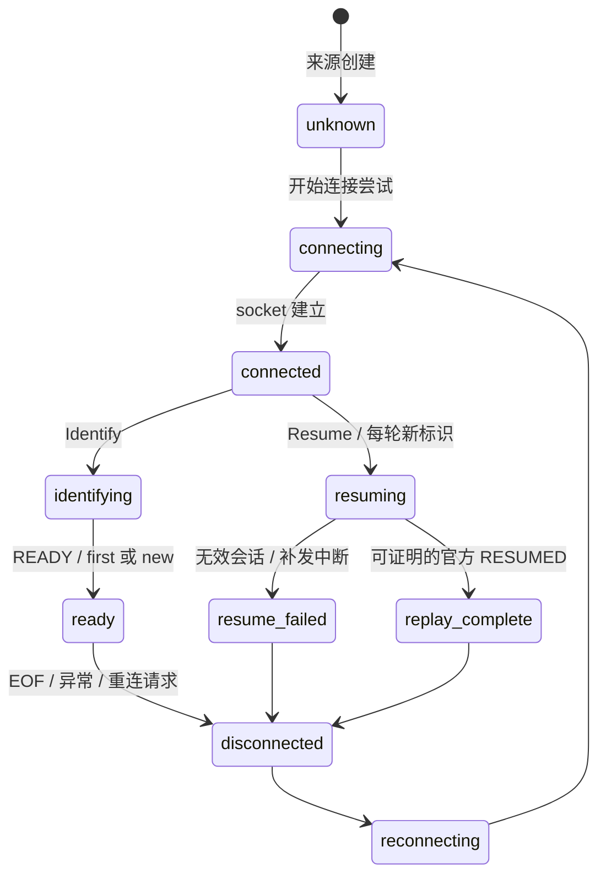

# 模块连接与会话状态（API v1）

模块通过 `ModuleContext` 订阅框架实际观察到的传输、会话事实，也可同步查询当前快照。
本接口独立于插件匹配、启停、维护及黑白名单；连接通知不等待订阅回调。

```python
async def setup(ctx):
    if getattr(ctx, 'connection_status_api_version', 0) < 1:
        raise RuntimeError('需要连接状态 API v1')

    async def observe(status):
        # 依据自身业务策略失效或记录状态；这里不代表本地恢复处理完成。
        print(status.appid, status.transport, status.phase, status.continuity)

    subscription = ctx.subscribe_connection_status(
        observe, appid=None, transport=None, timeout=5.0, replay_current=True,
    )
    current = ctx.get_connection_status('示例 AppID', transport='websocket')
    capabilities = ctx.get_connection_capabilities('示例 AppID', transport='websocket')
    return subscription
```

## 查询与能力

- `ctx.connection_status_api_version == 1`；公开类型位于 `core.module.connection_status`。
- `get_connection_status(appid, *, transport='websocket')` 返回不可变 `ConnectionStatus`，从未注册的传输返回 `None`。
- `connection_statuses` 返回全部已注册 Bot/传输的当前快照元组，包括最后一次停止事实。移除 Bot 后不把旧停止状态解释为新 Bot 实例的状态。
- `get_connection_capabilities()` 参数同状态查询，返回当前来源的 `ConnectionCapabilities`，未知来源返回 `None`。
- 能力字段为 `transport_disconnect`、`session_resume`、`replay_boundary` 和 `reason`。能力可随来源及网关发现结果变化，应结合状态身份查询。

官方 WS 的恢复及补发能力仅在默认官方 API 发现官方 `wss` 网关后报告；当前识别主机为
`api.bot.qq.com`、`api.sgroup.qq.com`，使用默认 TLS 端口。自定义 WS URL（包括手工填写官方 URL）、
自定义 API 或发现的其他网关均为 `unverified_gateway`，不授予恢复与补发证明能力。
这是保守的能力发现规则，部署了代理的消费者不能只凭同名 RESUMED 获得连续性证明。

Webhook 为 `http_callback`，三个能力均为 `False`；注册后状态为 `unknown`。
收到 HTTP 事件或名为 READY/RESUMED 的回调，不生成 WS 断开、恢复或补发完成通知。
Webhook 启停只报告本地来源创建/停止，不证明回调地址可达、平台投递顺序或历史完整性。

## 状态及转换



任何阶段都可在本地关闭时进入 `stopped`；取消接收任务为 `connect_cancelled`，重连耗尽为
`reconnect_exhausted`，启动失败为 `start_failed`。只有 socket 曾建立才报告其实际 `disconnected`；
建连前失败保持 `unknown`，随后报告重试或耗尽。服务端重连请求原因为 `server_reconnect`，
正常读取结束为 `socket_eof`，异常为 `connection_error`，无效会话为 `invalid_session`。

`WSClient.connect()` 是返回协程的同步工厂，仍可 `await client.connect()` 或交给 `asyncio.create_task()`；
依赖 `inspect.iscoroutinefunction(WSClient.connect)` 检测方法类型的集成需要调整。
调用时记录本次启动请求所属的停机代际；`await client.close()` 使此前已创建但尚未执行的连接协程失效，
这些协程之后执行时直接返回，不建立 socket，也不发布新状态。停机后重新调用 `connect()` 才是有意重启。
被替换的客户端永久失去该 Bot/传输的状态来源所有权，排队连接或再次调用 `connect()` 均不能重新注册夺回来源；
当前替代客户端继续使用自己的代际。已经入队的旧通知仍按下文的身份与顺序规则处理。

重连耗尽只停止该轮接收循环，保留协议恢复参数及与之配对的公开会话身份。
同一当前客户端之后有意调用 `connect()` 时，会继续尝试 Resume，保持 `session_id`、`session_generation`、
`bot_generation`，并更换 `connection_generation`、`resume_attempt_id`。这保留耗尽后重试的既有协议行为；
只有官方链路的有效 RESUMED 才能证明服务端本轮补发结束。主动 `close()` 仍清除协议恢复参数，
之后有意重启使用 Identify，并在有效 READY 时产生新会话代际。

通知不包含异常消息、凭据或配置快照。

`continuity` 有三个值：

| 值 | 事实 |
| --- | --- |
| `unknown` | 没有本轮跨断线连续性证明；包括首次/新会话、断开、停止、Webhook 及未知网关 |
| `pending` | 正在尝试恢复同一已知官方会话，尚未收到本轮可靠补发结束边界 |
| `resumed` | 同一会话的本轮官方服务端补发已结束 |

`login_kind` 为 `first`（该 Bot 实例首次有效 READY）、`new`（该实例后续新 READY，会话已替换）、
`resume`（尝试或完成旧会话恢复），其他阶段可为 `None`。READY 本身不证明断线期间没有缺口。
无效会话不可恢复时沿用框架原行为清除协议 session/seq，下一次 Hello 发送 Identify；可恢复时仍可重试 Resume。

同一连接中重复 READY/RESUMED 不重复创建会话或补发结束边界；未请求的 RESUMED、
缺失/非法 READY 身份、缺失/非法或倒退的补发序号均保持 `unknown`。收到无法解析的载荷为 `invalid_payload`，该轮恢复不授予连续性证明。
只有一次有效 Resume 对应的首个 RESUMED 可建立边界，不能把迟到的状态当作新一轮恢复。
同一 socket 首次 Hello 已选择 Identify/Resume 后，重复 Hello 不再发送鉴权帧或更换恢复轮次，
报告 `unknown` / `unexpected_hello`，并使该轮恢复证明失效；后续 RESUMED 保持 `unknown`。
新的 socket 仍按正常 Hello 流程重新尝试恢复。

收到框架未支持或未识别的整数 opcode 时，报告 `unknown` / `unknown_opcode`；
缺失 `op` 或其类型不是整数时，报告 `unknown` / `invalid_opcode`，布尔值和浮点数也不作为整数操作码处理。
这些帧仍按既有规则更新接收序号，但不会触发已知协议操作，也不推断丢事件或重新启动鉴权。
通知保留当前会话及恢复轮次；这些帧本身不会撤销该轮后续有效 RESUMED 的证明资格，
新的 socket 也仍可正常尝试恢复。已有其他异常导致该轮无法证明时，仍保持原有保守规则。

## 身份、接收上下文与补发边界

`ConnectionStatus.context`、内置传输的 `Event.connection_context` 以及
`GroupLifecycleEvent.connection_context` 均使用不可变 `ConnectionContext`：

| 字段 | 生命周期与含义 |
| --- | --- |
| `appid`, `transport` | Bot 原始 AppID 和 `websocket` / `webhook`，不使用显示 ID |
| `runtime_id` | 应用状态管理器的随机标识，新应用/进程重启必定更换；不持久化 |
| `bot_generation` | BotInstance 的随机标识，凭据重建、移除后重新创建都会更换 |
| `connection_generation` | 每次 WS 连接尝试的随机标识，包括握手失败；Webhook 为 `None` |
| `session_generation` | 有效新 READY 产生的随机标识，Resume 保持不变；Webhook 为 `None` |
| `session_id` | 实际 READY 的原始会话 ID；没有证明时为 `None` |
| `resume_attempt_id` | 每次发送 Resume 前建立的新随机标识；新连接尝试或 Identify 清除 |
| `receive_index` | 该 WSClient 读取的 JSON 对象帧计数，跨其短断重连递增；HTTP 为本 Bot 实例回调读取计数 |
| `sequence` | 该帧实际整数 s，缺失或非法为 `None`；不是本地完成水位 |

这些标识只供相等比较；不能按 UUID 排序。新 Bot 实例或 WSClient 的 receive_index 可重新从零开始，
必须结合代际比较。自定义适配器没有内置接线时，Event 及群通知的 `connection_context` 为 `None`。
群通知其他原生身份、处理顺序及回执语义保持原契约。

`ConnectionStatus` 还提供进程内递增的 `revision`、`phase`、`reason`、`capabilities`，以及：

- `resume_from_sequence`：本轮 Resume 实际发送的 seq。
- `replay_end_sequence`：可靠 RESUMED 的实际 s。
- `replay_end_receive_index`：本轮 RESUMED 的固定接收位置，后续收到帧也不会改写此边界。

`resuming` 通知带起点；`replay_complete` 带起点和结束位置。通过相同的应用/Bot/连接/会话代际及
resume_attempt_id、接收位置，可以关联本轮补发期间观察到的事件。RESUMED 之后的事件仍可携带该轮标识，
应结合固定结束位置区分。状态查询的 context 会随读取进度更新，而 revision 仅在发布状态时增加；
订阅者已经收到的不可变快照不随之变化。

旧 Bot/传输被替换后，其来源凭据不能覆盖新来源的当前查询。已经排队的旧通知仍按顺序送达，
保留原代际；消费者应比较 revision 和身份，不能把异步回调收到的旧状态当作最新查询。
主动关闭清除该 WSClient 的协议恢复参数；重新启用属于新会话。新应用启动不读取历史恢复事实，
首次就绪仍为连续性未知。

## 订阅顺序、错误与卸载

仅接受 `async def` 回调和有限正数 timeout。返回的 `ConnectionStatusSubscription` 有：
`subscription_id`、`owner`、`appid`、`transport`、`timeout`、`active`、`cancel()` 及 `results`。
Bot/传输过滤参数为 `None` 时匹配全部；默认 `replay_current=True` 先排队当前匹配快照，
其 `is_snapshot=True`，不制造新的 revision，也不重放历史连接过程。正常状态通知的 is_snapshot 为 False。
设置 False 时只接收之后的通知，可随时显式查询当前事实。

状态更新和入队在传输读取/启停路径中同步完成，然后独立任务调用订阅者。
同一订阅者与 Bot/传输内串行；不同订阅者、不同 Bot/传输互不等待。每对只使用一个排空任务，
积压数据仍占用内存，不提供持久队列或全局限流。回调应短小并 await 自己需要覆盖的工作。

`results` 为最近 100 个 `ConnectionStatusResult` 的元组，含原状态快照、订阅身份、owner、
`outcome` 和可选异常类型 `error_type`，不保存异常消息。结果分别为：

| outcome | 含义 |
| --- | --- |
| `success` | 该次 await 的回调正常返回 |
| `error` | 调用或 await 该回调时抛出异常（含参数绑定错误），error_type 为类型名 |
| `timeout` | 该回调超时，已请求取消 |
| `cancelled` | 回调自身取消 |
| `unsubscribed` / `unloaded` | 手动取消 / 模块卸载，包含已排队及在途通知 |
| `busy` | 同一订阅者及 Bot/传输上一次被取消的回调尚未退出，本次未调用 |

Python 取消是协作式；吞取消的回调无法强停，其后续副作用也无法撤回。
未退出前对同一键保持 busy 隔离，其他键继续处理。失败结果单独记录日志，不更改传输事实，
不暂停其他消费者或 Bot。重复取消幂等。模块 disable、reload、setup 失败或取消时关闭原上下文订阅；
新 setup 使用新订阅身份，默认收到当前快照。

## 与本地完成机制的关系

[QQ 官方协议](https://bot.q.qq.com/wiki/develop/api-v2/dev-prepare/interface-framework/event-emit.html)
定义 RESUMED 为服务端本轮遗漏事件补发结束。网络收到、READY、RESUMED、通知回调成功，
均不能证明其他模块、插件、数据库写入或自行派生的后台任务已经完成。
本接口保留既有心跳和 Resume 的接收序号行为，不把其替换为业务完成序号。
需要本地处理完成保证的机制须另行关联事件与处理回执，并处理失败、重载和未知链路。
